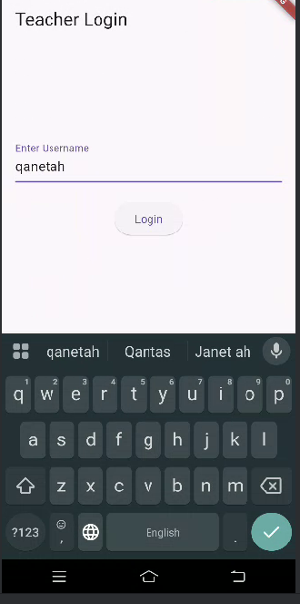
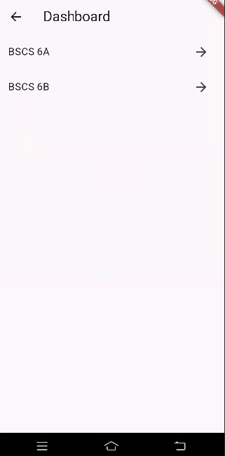
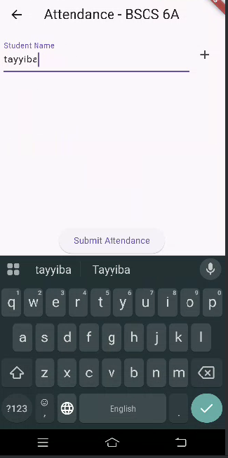
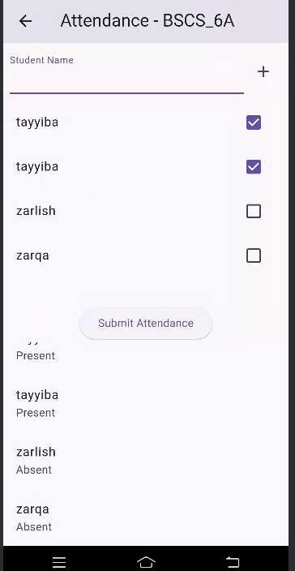

# 📱 Class Attendance Mobile App

<div align="center">

[](https://flutter.dev)
[](https://dart.dev)
[](https://firebase.google.com/)
[](https://flutter.dev)
[](https://opensource.org/licenses/MIT)

**A modern, intuitive, and real-time mobile application for classroom attendance management powered by Flutter and Firebase Realtime Database.**

[View Repository](https://github.com/t-kiran-05/Class-Attendence-MobApp) • [Report Bug](https://github.com/t-kiran-05/Class-Attendence-MobApp/issues) • [Request Feature](https://github.com/t-kiran-05/Class-Attendence-MobApp/issues)

</div>

---

## 📌 Table of Contents

- [Overview](#-overview)
- [App Preview & Screenshots](#-app-preview--screenshots)
- [Key Features](#-key-features)
- [Application Flow](#-application-flow)
- [Database Schema](#-database-schema)
- [Tech Stack](#-tech-stack)
- [Project Structure](#-project-structure)
- [Getting Started](#-getting-started)
  - [Prerequisites](#prerequisites)
  - [Installation & Setup](#installation--setup)
  - [Firebase Configuration](#firebase-configuration)
- [Running the App](#-running-the-app)
- [Future Enhancements](#-future-enhancements)
- [Contributing](#-contributing)
- [License](#-license)
- [Author](#-author)

---

## 📖 Overview

The **Class Attendance Mobile App** simplifies daily attendance workflows for teachers and educators. Instead of maintaining paper rosters or bulky spreadsheets, educators can quickly log in, pick their assigned class, dynamically add students, mark attendance with a single tap, and sync records instantly to the cloud with Firebase Realtime Database organized by date and class section.

---

## 📸 App Preview & Screenshots

<div align="center">
  <table>
    <tr>
      <th align="center"><b>1. Teacher Login</b></th>
      <th align="center"><b>2. Class Dashboard</b></th>
      <th align="center"><b>3. Add Students</b></th>
      <th align="center"><b>4. Mark & Submit Attendance</b></th>
    </tr>
    <tr>
      <td align="center">
        
      </td>
      <td align="center">
        
      </td>
      <td align="center">
        
      </td>
      <td align="center">
        
      </td>
    </tr>
    <tr>
      <td align="center"><i>Validated teacher login access</i></td>
      <td align="center"><i>Select class sections (e.g. BSCS 6A, 6B)</i></td>
      <td align="center"><i>Dynamically add enrolled students</i></td>
      <td align="center"><i>Checkmark Present/Absent & submit</i></td>
    </tr>
  </table>
</div>

---

## ✨ Key Features

- **🔐 Teacher Login Authentication**: Clean login screen with field validation to prevent empty submissions.
- **🏫 Class Dashboard**: Organized dashboard showing all enrolled class sections (`BSCS 6A`, `BSCS 6B`, etc.) with quick touch navigation.
- **👥 Dynamic Student Enrollment**: Add new students in real time via an intuitive input field without leaving the attendance session.
- **✅ Quick Attendance Toggling**: One-tap checkbox toggles allowing teachers to quickly designate students as **Present** or **Absent**.
- **☁️ Real-time Cloud Synchronization**: Instant upload to **Firebase Realtime Database** ensuring data is accessible from anywhere.
- **📅 Automated Date Tagging**: Automatically formats and tags submissions with the current date (`YYYY-MM-DD`) using the `intl` package.
- **📋 Post-Submission Audit**: On-screen instant summary and confirmation snackbar showing submitted attendance states.

---

## 🔄 Application Flow

```mermaid
flowchart LR
    A([Teacher Opens App]) --> B[Teacher Login Screen]
    B -->|Validate Credentials| C[Class Dashboard Screen]
    C -->|Select Section e.g. BSCS 6A| D[Attendance Screen]
    D -->|Input Name & Click +| E[Add Students to Roster]
    E --> F[Toggle Checkboxes: Present / Absent]
    F --> G[Click Submit Attendance]
    G --> H[(Firebase Realtime Database)]
    H --> I[Show Confirmation & Submitted Summary]
```



---

## 🗄️ Database Schema

Attendance entries are stored in **Firebase Realtime Database** using a hierarchical tree structured by class section and date:

```json
{
  "attendance": {
    "BSCS_6A": {
      "2026-10-13": {
        "tayyiba": "Present",
        "zarlish": "Absent",
        "zarqa": "Absent"
      }
    },
    "BSCS_6B": {
      "2026-10-13": {
        "ali_khan": "Present",
        "fatima_noor": "Present"
      }
    }
  }
}
```

### Path Breakdown:
- `/attendance` &rarr; Root node for all records
- `/{class_name}` &rarr; Sanitized class identifier (e.g. `BSCS_6A`)
- `/{YYYY-MM-DD}` &rarr; ISO date string formatted via `DateFormat('yyyy-MM-dd')`
- `/{student_name}` &rarr; Status key mapped to `"Present"` or `"Absent"`

---

## 🛠️ Tech Stack

| Technology | Purpose |
| :--- | :--- |
| **[Flutter](https://flutter.dev)** | Cross-platform UI toolkit (SDK ^3.8.0) |
| **[Dart](https://dart.dev)** | Object-oriented client-optimized language |
| **[Firebase Core](https://pub.dev/packages/firebase_core)** | Firebase initialization & ecosystem integration |
| **[Firebase Database](https://pub.dev/packages/firebase_database)** | Real-time NoSQL cloud database synchronization |
| **[intl](https://pub.dev/packages/intl)** | Date and time formatting (`yyyy-MM-dd`) |
| **[Material Design](https://m3.material.io/)** | Clean Material UI layout and themed components |

---

## 📂 Project Structure

```text
Class-Attendence-MobApp/
│
├── android/                   # Native Android configuration & gradle files
│   └── app/
│       └── google-services.json # Firebase configuration file
│
├── assets/                    # Project visual assets & screenshots
│   ├── a1.png                 # Login screen preview
│   ├── a2.png                 # Dashboard screen preview
│   ├── a3.png                 # Add student screen preview
│   ├── a4.png                 # Attendance submission preview
│   └── screenshots/           # Formatted showcase images for README
│       ├── 01_teacher_login.png
│       ├── 02_class_dashboard.png
│       ├── 03_add_student.png
│       └── 04_mark_attendance.png
│
├── lib/
│   └── main.dart              # Core app entry point & UI screens
│                              # (LoginScreen, DashboardScreen, AttendanceScreen)
│
├── test/
│   └── widget_test.dart       # Widget and UI smoke tests
│
├── pubspec.yaml               # Flutter package configuration & dependencies
├── analysis_options.yaml      # Static analysis & linting rules
├── .gitignore                 # Git ignore rules for Flutter/Android/IDE
└── README.md                  # Project documentation
```

---

## 🚀 Getting Started

### Prerequisites

Ensure you have the following installed on your machine:
- [Flutter SDK](https://docs.flutter.dev/get-started/install) (`v3.8.0` or higher)
- [Dart SDK](https://dart.dev/get-dart)
- [Android Studio](https://developer.android.com/studio) or [VS Code](https://code.visualstudio.com/) with Flutter extensions
- An active [Firebase](https://firebase.google.com/) account

### Installation & Setup

1. **Clone the repository**:
   ```bash
   git clone https://github.com/t-kiran-05/Class-Attendence-MobApp.git
   cd Class-Attendence-MobApp
   ```

2. **Install Flutter packages**:
   ```bash
   flutter pub get
   ```

### Firebase Configuration

1. Create a Firebase project at the [Firebase Console](https://console.firebase.google.com/).
2. Enable **Firebase Realtime Database** in test or locked mode with appropriate read/write rules:
   ```json
   {
     "rules": {
       ".read": true,
       ".write": true
     }
   }
   ```
3. Register an Android app with package name `com.example.a3` (or your configured package name).
4. Download `google-services.json` and place it in:
   ```text
   android/app/google-services.json
   ```

---

## 💻 Running the App

### Debug Mode
Connect an Android device or start an emulator, then execute:
```bash
flutter run
```

### Run Tests
To run unit and widget smoke tests:
```bash
flutter test
```

### Build APK
To produce a release Android APK:
```bash
flutter build apk --release
```
The generated APK will be located at `build/app/outputs/flutter-apk/app-release.apk`.

---

## 🔮 Future Enhancements

- [ ] 🔐 **Firebase Authentication**: Full user signup and role-based login (Admin, Teacher, Student).
- [ ] 📊 **Attendance Reports & Analytics**: Historical attendance percentages and charts.
- [ ] 📄 **Export Options**: Export attendance sheets to PDF and Excel (`.xlsx` / `.csv`).
- [ ] 📶 **Offline Persistence**: Local SQLite / Hive caching when network connection is unavailable.
- [ ] 🔔 **Push Notifications**: Automated alerts to parents/students for absences.

---

## 🤝 Contributing

Contributions, issues, and feature requests are welcome!

1. Fork the Project
2. Create your Feature Branch (`git checkout -b feature/AmazingFeature`)
3. Commit your Changes (`git commit -m 'Add some AmazingFeature'`)
4. Push to the Branch (`git push origin feature/AmazingFeature`)
5. Open a Pull Request

---

## 📄 License

This project is licensed under the MIT License - see the [LICENSE](LICENSE) file for details.

---

## 👤 Author

**Tariq Kiran**
- GitHub: [@t-kiran-05](https://github.com/t-kiran-05)
- Repository: [Class-Attendence-MobApp](https://github.com/t-kiran-05/Class-Attendence-MobApp)

---

<div align="center">
  <sub>Built with ❤️ using Flutter & Firebase</sub>
</div>
